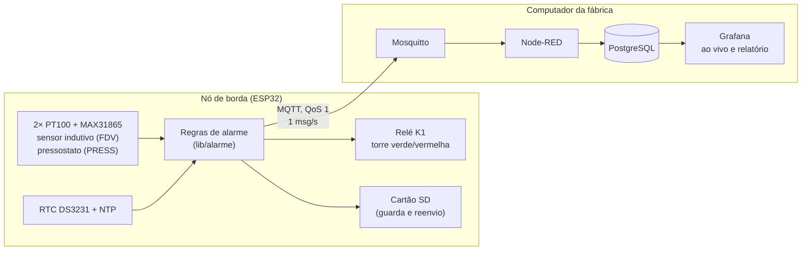

# Edge-HTST

Nó de borda com ESP32 que monitora um pasteurizador HTST de leite **de forma independente do CLP**, com uma aplicação local que guarda e mostra os dados. Trabalho de Conclusão de Curso em Engenharia de Software.

O nó mede a temperatura de pasteurização (`T1`) e de saída (`T2`) com dois PT100, lê a posição da válvula de desvio (`FDV`) e a pressão de ar (`PRESS`), aplica as regras de alarme e aciona uma torre de sinalização verde/vermelha. Cada leitura vai para um cartão SD e, por MQTT, para um computador na fábrica, onde fica num banco PostgreSQL e aparece no Grafana.

> O firmware **nunca comanda a válvula de desvio** nem qualquer atuador do processo. O único atuador é o relé `K1` da torre, e relé desenergizado significa vermelho (falha segura).

## Arquitetura



- **Regras de alarme isoladas:** `firmware/lib/alarme` não depende de Arduino nem de hardware. Recebe as leituras e devolve as condições ativas e o estado da torre, e é testada no PC.
- **Sem perda de dados:** sem rede ou sem broker, o nó continua gravando no SD e reenvia as pendências quando a conexão volta. O `seq` é crescente e persistente, e o banco descarta repetidas pela chave (`device_id`, `seq`).
- **Nada bloqueia a torre:** rede, SD e MQTT rodam fora do caminho das regras de alarme.

## Estrutura do repositório

| Pasta | Conteúdo |
|---|---|
| [`spec/`](spec/) | Especificações: firmware ([FRS v1.5](spec/FRS_Edge-HTST_v1.5.md)) e aplicação ([SRS v1.0](spec/SRS_Aplicacao-HTST_v1.0.md)) |
| [`docs/`](docs/) | Plano, tarefas, decisões de projeto, fluxograma do firmware e verificação de cada requisito |
| [`firmware/`](firmware/) | Projeto PlatformIO do ESP32: `src/` (hardware), `lib/` (lógica sem hardware), `test/` (testes no PC) |
| [`aplicacao/`](aplicacao/) | Mosquitto, fluxo do Node-RED, SQL do banco, dashboards do Grafana e instalador para Windows |
| [`bancada/gerador-pulsos/`](bancada/gerador-pulsos/) | Firmware auxiliar que gera pulsos curtos para testar o filtro das entradas (FW-02) |

## Hardware

| Item | Ligação |
|---|---|
| ESP32 DevKit V1 (30 pinos) | perfil PlatformIO `esp32doit-devkit-v1` |
| MAX31865 T1 / T2 (PT100, Rref 430 Ω) | VSPI, CS **5** (T1) e **17** (T2) |
| Sensor indutivo da válvula (`FDV`) | GPIO **27** |
| Pressostato (`PRESS`) | GPIO **26** |
| Botão do modo limpeza (`BTN_LIMP`) | GPIO **34**, pull-up externo de 10 kΩ |
| Relé `K1` da torre (via BC547) | GPIO **4** |
| Cartão MicroSD | SCK 14, MISO 32, MOSI 13, CS 15 |
| RTC DS3231 | I²C |

Os pinos estão em [`firmware/src/config.h`](firmware/src/config.h).

## Firmware

Requisitos: [VS Code](https://code.visualstudio.com/) com a extensão [PlatformIO](https://platformio.org/). Abra sempre pelo arquivo `edge-htst.code-workspace`.

1. Copie `firmware/include/segredos.exemplo.h` para `firmware/include/segredos.h` e preencha o Wi-Fi e o endereço do broker. Esse arquivo fica fora do Git.
2. Compile e grave na placa:
   ```
   cd firmware
   pio run -t upload
   pio device monitor
   ```
3. Rode os testes de lógica no PC, sem placa:
   ```
   pio test -e native
   ```

Os parâmetros (temperatura mínima, faixa válida, tempos, offsets) são ajustados pela Serial, sem recompilar, e ficam gravados na memória do ESP32:

```
get                  mostra os valores atuais
set T_MIN 72.0       altera um parâmetro
```

## Aplicação

A aplicação roda num computador Windows na rede local da fábrica: **Mosquitto** (broker), **Node-RED** (grava no banco), **PostgreSQL 18** e **Grafana**. Mosquitto, Node-RED e Grafana são instalados como serviços e sobem sozinhos com o Windows.

Instalação por pendrive, sem internet no computador da fábrica:

1. Num computador com internet, baixe para a pasta Downloads os instaladores do PostgreSQL, Node.js, Mosquitto e Grafana (Windows x64). Depois monte o pendrive, que copia os instaladores e baixa o Node-RED:
   ```powershell
   powershell -ExecutionPolicy Bypass -File aplicacao\instalador\preparar_pendrive.ps1 -Destino E:\htst-instalacao
   ```
2. No computador da fábrica, clique com o botão direito em `instalar.cmd` no pendrive → **Executar como administrador**. Ele pede as senhas, instala tudo, cria o banco e importa os dashboards.
3. Abra o Grafana em `http://localhost:3000`.

O registro da instalação manual, passo a passo, está em [`docs/instalacao-aplicacao.md`](docs/instalacao-aplicacao.md).

## Requisitos e verificação

O projeto segue desenvolvimento guiado por especificação: todo código atende a um requisito `FW-xx` (firmware) ou `SW-xx` (aplicação). A evidência de cada teste fica em [`docs/verificacao.md`](docs/verificacao.md) e [`docs/verificacao-aplicacao.md`](docs/verificacao-aplicacao.md), e as decisões em [`docs/decisoes.md`](docs/decisoes.md).

| Bloco | Requisitos |
|---|---|
| 1. Leituras | FW-01, FW-02 |
| 2. Alarme, relé e modo limpeza | FW-03 a FW-06 |
| 3. Falha de sensor e hora | FW-07, FW-08 |
| 4. SD, MQTT, guarda e reenvio | FW-09 a FW-12 |
| 5. Watchdog e autoteste | FW-13, FW-14 |
| Aplicação | SW-01 a SW-14 |

## Licença

[MIT](LICENSE). Autor: Gustavo Correa A. Moreira.
