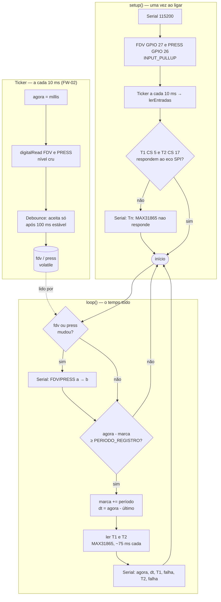
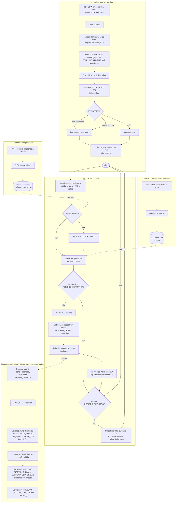
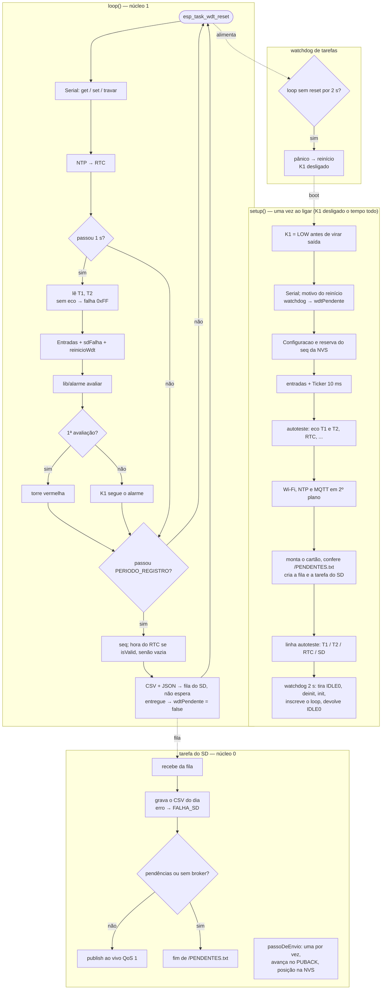

# Fluxograma do firmware

Atualizado a cada bloco fechado. Base: `spec/FRS_Edge-HTST_v1.5.md`.

## Bloco 1 — leituras (FW-01, FW-02) · 05/11/2026

Por que dois caminhos: a leitura do PT100 trava ~150 ms por ciclo; as entradas ficam no Ticker para continuarem sendo amostradas a cada 10 ms nesse intervalo.

(Os blocos 2 e 3 estão no diagrama abaixo.)

## Blocos 2 e 3 — alarme, torre, limpeza, falha de sensor e hora (FW-03 a FW-08) · 07/11/2026

O bloco 2 não teve fechamento próprio (pendências de bancada: FW-05 com relé + BC547, FW-04 com 30 repetições); o diagrama abaixo mostra o firmware como está ao fim do bloco 3.

Três "linhas de execução": o Ticker (entradas a cada 10 ms), a tarefa de rede do ESP32 (Wi-Fi e NTP) e o `loop()`. As duas primeiras só deixam valores prontos (`volatile`); quem decide e mexe no hardware (K1, RTC) é sempre o `loop()`.

Ainda não existe: SD, MQTT e reenvio (bloco 4), watchdog e autoteste (bloco 5).

## Blocos 4 e 5 — SD, MQTT, reenvio, watchdog e autoteste (FW-09 a FW-14) · 07/11/2026

O bloco 4 ainda não foi fechado (falta a tarefa 7: 24 h com SD e queda longa de rede); o diagrama mostra o firmware como está ao fim do bloco 5.

Quatro "linhas de execução": Ticker (entradas), rede (Wi-Fi, NTP, MQTT), tarefa do SD (cartão e envio) e `loop()` (regras e torre). Só o `loop()` mexe no K1; tudo que pode esperar (cartão, rede) está fora dele, e o watchdog garante que, se o `loop()` parar, o nó reinicia com a torre vermelha.
